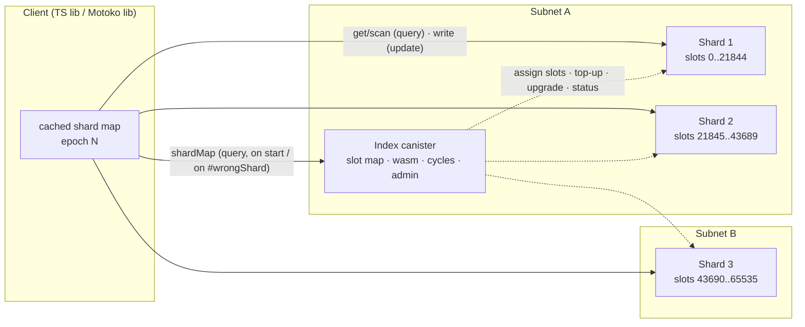

# Ekvm v2: Design

Status: draft for review · 2026-11-13 · License: Apache-2.0 (same as v1)

Ekvm ("Elastic Key-Value Map") is a Motoko library for running a key-value store across many canisters on the Internet Computer. This document covers a rewrite. The v1 code (`BarFTW/Ekvm`, 2024) is a reference for the idea only. No v1 code is reused.

Facts marked **[unverified]** were not confirmed in official docs while this was written. They must be checked before we depend on them.

---

## 1. Why a rewrite, and what changed since 2024

v1 was built because a single canister couldn't hold a meaningful database. That reason has mostly gone away:

| Limit (today) | Value | Source |
|---|---|---|
| Stable memory per canister | 500 GiB | [Resource limits][limits] |
| Wasm heap per canister | 4 GiB (wasm32), 6 GiB (wasm64) | [Resource limits][limits] |
| Subnet total memory | 2 TiB, shared by all canisters on the subnet | [Resource limits][limits] |
| Update execution threads | 1 per canister, 4 per subnet | [Resource limits][limits] |
| Query execution threads | 2 per canister, 4 per replica node | [Resource limits][limits] |
| Instructions | 40 B per update, 5 B per query | [Resource limits][limits] |
| Payload | 2 MiB ingress, 2 MiB cross-subnet, 10 MiB same-subnet request | [Resource limits][limits] |
| Block rate | 1–3 blocks/s, up to 1,000 messages per block | [Resource limits][limits] |
| Latency | update ~1–2 s, query ~200 ms | [Canisters][canisters], [Inter-canister calls][icc] |

Motoko now uses **enhanced orthogonal persistence (EOP)** by default (since moc 0.15.0). A `persistent actor` keeps its 64-bit heap across upgrades without serializing it, and upgrade time no longer grows with heap size ([EOP][eop], [overview][op]).

**The real problem is throughput, not size.** The target workload is an advertiser/publisher bidding system: millions of ads, hundreds of thousands of campaigns, and lookups at internet speed. At a few KB per ad that is single-digit GB, which fits one canister. What doesn't fit one canister:

- **Writes.** A canister executes one update at a time, and a subnet has only 4 update threads. Write throughput therefore scales only by spreading shards over **multiple subnets**.
- **Reads.** Queries are cheap and parallel, but each canister gets at most 2 query threads per node, so the hot read set has to be spread across canisters too.
- **Storage headroom.** 500 GiB per canister is a ceiling, not a promise, because all canisters on a subnet share 2 TiB. Above 750 GiB of subnet usage, storage reservation fees start ([cycle costs][cycles]).

Unbounded size comes for free once the design scales out.

### v1 problems this design removes

| v1 issue | v2 answer |
|---|---|
| Index canister on every `get`/`put` (two to three hops) | Clients route directly to shards using a cached shard map (§4) |
| `put` and `addKeyToShard` callable by anyone | Allowlist checked inside each shard; admin restricted to controllers (§6) |
| Heap BTree described as "stable memory"; `stableVarQuery` used as a memory check | EOP heap, stated plainly; memory measured with `canister_status`/runtime stats (§5) |
| Shard growth never wired up | Explicit split/move protocol driven by the index (§4.3) |
| 15 B cycles attached to every call | No cycles on data calls. Cycles move only for creation and top-ups (§7) |
| No top-up, no child upgrades | Index runs top-up and rolling upgrades (§7, §8) |
| No delete; overwrite left a stale location | No per-key location directory. Location is a pure function of the key, so delete and overwrite are local (§4) |

### Prior art

- **CanDB** (canscale → [ORIGYN-SA/CanDB][candb]) uses a partition-key/sort-key model with a canister per partition. Its repo was last pushed 2024-03-20, so treat it as dormant. Ekvm v2 borrows the PK/SK idea and adds client-side routing and rebalancing.
- **`mo:core/Map`** ([motoko-core][core], v2.7.0) is a B-tree of order 32 that is stable under EOP. It is derived from the same StableHeapBTreeMap that v1 used, and it is our in-shard index.

---

## 2. Goals / non-goals

**Goals**
1. Horizontal write and read throughput: add shards, including on other subnets, without downtime.
2. One network hop per operation on the hot path. The index is never consulted per request.
3. Per-key linearizable writes, optimistic concurrency (version / CAS), and idempotent retries.
4. Ordered range scans within a partition key, so the common bidding pattern of "all ads of campaign X" hits one shard.
5. Operable by one person: automatic cycle top-ups, rolling upgrades with snapshots, metrics.
6. A Motoko library (mops package) plus a TypeScript client.

**Non-goals (v1 of the rewrite)**
- Cross-shard transactions or global secondary indexes.
- Ordered scans across partition keys (global range queries).
- Certified (subnet-signed) query responses. See open question Q2.
- Running the auction itself. Ekvm stores and serves data; ranking logic belongs to the app.
- Mainnet deployment or cycle purchasing tooling.

---

## 3. Data model and API

**Key** = `(pk : Blob, sk : Blob)`.
- `pk` (partition key) decides placement, e.g. `campaignId`.
- `sk` (sort key) orders data within a partition, e.g. `adId`, or `"bid#" # ts`.

**Value** = `Blob`, at most 1 MiB, so a batch still fits under the 2 MiB message limit. Each entry also carries a `version : Nat64` (a per-shard monotonically increasing write counter) and an optional `ttl`.

### Shard API (Candid; the client library wraps it)

```motoko
type Key     = { pk : Blob; sk : Blob };
type Entry   = { key : Key; value : Blob; version : Nat64 };
type Cond    = { #any; #absent; #version : Nat64 };          // CAS
type WriteOp = { #put : { key : Key; value : Blob; cond : Cond }
               ; #delete : { key : Key; cond : Cond } };
type Err     = { #wrongShard : { epoch : Nat64 }              // client must refresh map
               ; #conflict : { key : Key; current : ?Nat64 }
               ; #unauthorized; #tooLarge; #migrating };

// updates
write  : (req : { epoch : Nat64; requestId : Blob; ops : [WriteOp] })
           -> async Result<[Nat64], Err>;   // all-or-nothing within one shard
// queries
get    : query ({ epoch : Nat64; keys : [Key] }) -> async Result<[?Entry], Err>;
scan   : query ({ epoch : Nat64; pk : Blob; from : ?Blob; to : ?Blob;
                  limit : Nat; reverse : Bool }) -> async Result<{ entries : [Entry]; next : ?Blob }, Err>;
```

- A batch `write` to one shard executes as a single message, so it is atomic.
- The client library splits a multi-key batch by shard and sends the parts in parallel. Across shards there is **no** atomicity (§9).
- `scan` is paginated by an instruction budget as well as `limit`, so it stays under the 5 B query instruction limit.

### Index API

```motoko
shardMap   : query () -> async { epoch : Nat64; slots : [(Nat16, Nat16, Principal)] }  // slot ranges → shard
// admin, controllers only:
addWriter / removeWriter / setReaders;  addShard(subnet : ?Principal);  moveSlots(range, to);
uploadShardWasm(chunk) / commitShardWasm(sha256);  upgradeShards(plan);  status()
```

---

## 4. Architecture



### 4.1 Partitioning: fixed hash slots, not a ring

- `slot = hash(pk) mod 65536`, using SHA-256 truncated to 16 bits so the hash is stable across languages.
- The slot map assigns contiguous slot ranges to shards. This is the Redis Cluster model.
- **Why slots and not a consistent-hash ring:** moving one slot range is an explicit, bounded unit of migration. The map is small (ranges, typically under 1 KB). Ownership is easy to verify on the shard side.
- **Why hash and not range partitioning:** hashing spreads hot campaigns. Ordered scans are still available *within* a `pk`, which covers the bidding access pattern. Global ordered scans are a non-goal (see Q1).
- **Hot partition caveat:** a single `pk` can't be split. If one campaign could exceed one shard's write rate, the app has to shard that key itself, e.g. `pk = campaignId # bucket`.

### 4.2 Client-side routing

- The client fetches `shardMap` once with a query and caches it with its `epoch`. It then calls shards directly.
- Every request carries the client's `epoch`.
- Each shard holds its own copy of the ranges it owns, pushed by the index. It answers `#wrongShard { epoch }` when it doesn't own the slot. The client then refreshes the map and retries once.
- The index is never on the hot path. If the index is down, data traffic continues.
- Composite queries are **same-subnet and ingress-only** ([Canisters][canisters]). They therefore can't be the general fan-out mechanism. Cross-shard reads are fanned out by the client in parallel.

### 4.3 Split / move protocol

The index runs the protocol. Each step is persisted before every `await`, so a crash or trap resumes from a timer.

1. **Trigger.** A shard exceeds a configured write rate or memory threshold (default: heap > 2 GiB), or the operator calls `moveSlots`. The index creates the target shard if needed.
2. **Copy.** The source shard marks range R as `migrating → T` and starts a per-range change log. The index pulls snapshot pages from the source and pushes them to T with batched `write` calls. During this phase the source still serves reads and writes for R.
3. **Catch-up.** The index replays the change log to T, repeating until the log is small.
4. **Cutover.** The source freezes writes on R (writes get `#migrating` and the client retries with backoff). The index drains the final log, then:
   - T becomes owner of R.
   - The source drops ownership of R.
   - The index bumps `epoch`.

   The freeze lasts roughly 2–3 update rounds.
5. **Cleanup.** The source deletes R's data in background batches, using a timer and staying within the instruction budget.

Merging two shards is the same protocol run in reverse. Shard deletion is manual for now.

---

## 5. Storage inside a shard

**Decision: EOP heap with `mo:core/Map<Blob, Entry>`, keyed by `pk ‖ sk` with a length prefix.**

- **Pros:** no manual memory layout, native-speed access, upgrades independent of heap size, and type-checked upgrade compatibility ([EOP][eop]).
- **Cons:** capacity is bounded by the heap (6 GiB on wasm64), and EOP's 64-bit layout can use up to 2× more memory ([changelog][changelog]). We keep shards well under that: the 2 GiB split trigger leaves GC and migration headroom. For this workload, the throughput limits trigger a split long before size does.
- **Regions (stable memory), rejected for v1.**
  - The docs say to use them "only if enhanced orthogonal persistence does not fit your use case". Access is "significantly higher" cost, and layout and free-space management are manual ([Stable memory and regions][regions]).
  - The default page cap is also inconsistent in the docs: the compiler reference says `--max-stable-pages` defaults to 100 GiB ([compiler ref][mocref]), while `core/Region.mo` says 4 GiB. **[unverified which applies]**
  - We keep storage behind a `Store` interface so that a Region-backed store can be added later, e.g. for very large cold values.
- **Memory measurement:** heap size from the runtime (`Prim.rts_heap_size` / `rts_memory_size`) and `canister_status.memory_metrics` from the index. **[unverified: exact core API names]**
- Set `wasm_memory_limit` on each shard as a hard stop, plus `wasm_memory_threshold` so a low-memory hook fires early ([management canister][mgmt]). **[unverified: Motoko `system func lowmemory` support]**
- **Rescue path:** a controller-only `exportRange` query, as recommended in the EOP docs.

---

## 6. Access control

| Role | Who | Can |
|---|---|---|
| Admin | Controllers of the index (`Principal.isController`) | Everything in the index admin API |
| Writer | Principals on the allowlist (user principals or app canisters) | `write` on shards |
| Reader | `public`, or an allowlist (configurable) | `get`, `scan` |
| Index | The index canister principal | Internal shard methods: assign slots, migrate, export |

- Shards hold their own copy of the allowlist, pushed by the index on change and versioned. Authorization is a local check, with no call on the hot path.
- Shard controllers are the index plus an optional operator principal kept as a break-glass rescue. The shard `status_visibility` is set to the index.
- `system func inspect` rejects ingress from non-writers early, which limits cycle drain from spam updates. It is a single-replica filter, so methods still re-check the caller.
- Internal methods check `caller == index` explicitly. This fixes v1's open `put` and `addKeyToShard`.

---

## 7. Cycles

Official costs on a 13-node subnet ([cycle costs][cycles]):

| Operation | Cost |
|---|---|
| Canister creation | 500 B cycles |
| Update base fee | 5 M cycles + 1 cycle per instruction |
| Ingress | 1.2 M per message + 2 K per byte |
| Inter-canister call | 260 K + 1 K per byte |
| Queries | free |
| Storage | ~329 B per GiB per month |

On the fiduciary subnet, multiply by ×2.6. Use the `ic0.cost_*` APIs instead of hard-coding these numbers ([management canister][mgmt]).

- **Data calls carry no cycles.** v1 attached 15 B cycles to each call (about 3,000× an update base fee), and this was removed. The receiving shard pays for ingress and execution from its own balance.
- **Creation:**
  - Same subnet: the index calls `create_canister` with `creation fee + initial balance` attached (default initial balance 2 T).
  - Another subnet: the management canister creates on the caller's subnet ([forum][subnetq]), so this goes through the CMC `create_canister` with `subnet_selection`. **[unverified: CMC call shape from a canister]** ([subnet selection][subsel])
- **Top-up:** a timer in the index (default every 10 min) reads each shard's `canister_status` (cycles, `idle_cycles_burned_per_day`, memory). It sends `deposit_cycles` when a shard's balance drops below `max(7 × daily burn, 1 T)`.
- **Freezing threshold** is left at the default of 30 days.
- **Index funding** is the operator's job. The index exposes its own projected runway, and `status()` raises a `lowCycles` flag well before shards would freeze.
- **Reserved cycles:** on subnets above 750 GiB, memory growth reserves cycles. Monitoring includes `reserved_cycles`, and subnet choice should avoid full subnets.

---

## 8. Upgrading child canisters

- **Wasm storage:** the operator uploads the shard wasm to the index in chunks of 2 MiB or less, then calls `commitShardWasm(sha256)`. The index keeps the current and previous wasm.
  - Install uses `install_code` (a same-subnet request can be up to 10 MiB). For cross-subnet shards, or modules over the limit, use `upload_chunk` on the target plus `install_chunked_code` ([management canister][mgmt]).
- **Upgrade mode:** `#upgrade` with `wasm_memory_persistence = ?#keep`, which EOP requires. Never use `#reinstall` or `replace`, because both drop the heap ([EOP][eop]).
- **Rolling plan:**
  1. Snapshot (`take_canister_snapshot`, replacing the previous one).
  2. Stop the canister. Shards make no outgoing calls, so it drains fast.
  3. Upgrade.
  4. Start.
  5. Health check (`version()`, sample `get`).

  Order: one canary shard, then batches of N. On failure, `load_canister_snapshot`, halt the plan, and report.
- **Compatibility rule:** shard Candid changes are additive only, so clients and mixed-version shards keep working during a roll. EOP also rejects incompatible stable-type changes on upgrade, which leaves the shard unchanged.
- A stopped shard is unavailable for about one round per upgrade. Clients see a reject and retry. This is acceptable because only one batch is down at a time.

---

## 9. Consistency and failure modes

| Scope | Guarantee |
|---|---|
| Single key, update path | Linearizable (single-threaded canister, atomic message) |
| Batch on one shard | Atomic, all-or-nothing |
| Batch across shards | Per-shard atomic only. Partial success is reported per shard |
| `get`/`scan` (query) | Answered by one replica: may lag slightly and is **not certified** |
| Read-your-writes | Use `getCertainly` (the same `get` sent as an update), ~1–2 s |

- **Idempotency:** each `write` carries a client-chosen `requestId`. Shards keep a dedupe table (requestId → result) with a TTL (default 10 min), so retries after a timeout or a `SYS_UNKNOWN` are safe. CAS (`#version`) protects read-modify-write cycles.
- **Index orchestration across `await`s** (top-up, split, upgrade):
  - Each step is a persisted state machine with a per-range lock.
  - Steps are written idempotently, e.g. `assignSlots(epoch)` is a no-op if already applied.
  - Inter-canister calls state is not rolled back on reject, so state is committed before each `await` and checked after.
  - Calls to our own shards use unbounded wait. Anything external, such as the CMC, uses bounded wait (`with timeout`) and treats `#system_unknown` as "check, then retry" ([Inter-canister calls][icc]).
- **Stale client map:** `#wrongShard` triggers a refresh and one retry. Correctness never depends on clients' maps being fresh, because shards are the authority.
- **Shard out of cycles or frozen:** its slots become unavailable, and the error surfaces to clients. The top-up margin (7 days of burn) and alerts are the mitigation. Data is not lost.
- **Index lost:** data traffic continues. A new index can rebuild the slot map from the shards, since each reports its own ranges and epoch.

---

## 10. Latency expectations for the bidding use case

| Path | Expected | Notes |
|---|---|---|
| Ad and campaign lookups (`get`, `scan` on one `pk`) | ~200 ms query round trip | One hop with a cached map. Scales with replicas × shards |
| Candidate fan-out over k shards | ~max of k parallel queries | Done by the client, not a composite query |
| Bid and budget writes | ~1–2 s | Batch them. Per subnet, the 4 update threads and ~1,000 messages per block are the ceiling, so add subnets to scale |
| Spend counters | ~1–2 s plus batching delay | Overspend bounded by the batch window. Exact pacing is the app's job |

Real-time per-impression auctions should therefore run on **query** reads of precomputed candidate sets, e.g. a `pk = segmentId` holding the ranked ad list. Writes update those sets asynchronously. This latency split is inherent to the IC and does not come from Ekvm. These numbers come from docs and have not been measured; M3 measures them.

---

## 11. Testing (local only, no mainnet)

- **Unit tests:** `mops test` covering the slot hash, the Store, the CAS/dedupe logic, and the migration state machine. Slot-hash vectors are shared with the TS client.
- **Integration tests:** `mops test --mode replica` on PocketIC (pinned version), plus `@dfinity/pic` from TypeScript for multi-canister and **multi-subnet** scenarios ([PocketIC][pic], [mops test][mopstest]). They cover:
  - put/get/delete/scan
  - stale epoch → `#wrongShard`
  - a split under concurrent writes, checked for no lost or duplicated writes
  - upgrade with EOP keep, plus snapshot rollback
  - top-up below threshold
  - access-control negatives
  - a trap injected mid-migration, followed by resume
- **Property test:** random op sequences against an in-memory model map, with random splits interleaved.
- **Load test:** on PocketIC or a local replica, measure instructions per op and the ops-per-message ceiling. This yields per-shard capacity numbers. Real latency can't be measured locally.
- No mainnet deployments and no real cycles without the user's explicit approval.

---

## 12. Milestones

| # | Deliverable | Done when |
|---|---|---|
| M0 | Repo skeleton (mops, moc pinned, PocketIC pinned), slot hash with cross-language vectors | `mops test` green |
| M1 | Single shard: Store on `core/Map`, write/get/scan/delete, CAS, dedupe, access control | Unit and replica tests green |
| M2 | Index plus static multi-shard: shard map query, epoch checks, TS client routing | Multi-shard integration green |
| M3 | Cycles: create, top-up, status/metrics. Instruction and throughput benchmarks | Benchmarks recorded in docs |
| M4 | Split/move protocol with crash-resume | Split-under-load test green |
| M5 | Wasm store and rolling upgrade with snapshots, multi-subnet placement (PocketIC) | Upgrade and rollback tests green |
| M6 | README, examples (ad catalog demo), v0.1.0 tag (local only, not published) | Review with the user |

---

## 13. Open questions

1. **Scans.** Is "ordered scan within a partition key, hash placement across keys" enough? Or does the ad system need global ordered range scans, e.g. by bid price across all campaigns? Global scans would require range partitioning and change §4.1.
2. **Trust in reads.** Is single-replica (uncertified) query data acceptable for auction reads? If advertisers must be able to *verify* fairness, we need certified data or update-path reads, which changes the latency budget.
3. **Scope.** Is the ad/bidding system an active project? If so, M3's benchmarks should use its real record sizes and write rates. If not, Ekvm v2 is a general library and the demo is synthetic.

---

## References

[limits]: https://docs.internetcomputer.org/references/resource-limits/
[cycles]: https://docs.internetcomputer.org/references/cycles-cost-formulas
[mgmt]: https://docs.internetcomputer.org/references/management-canister/
[canisters]: https://docs.internetcomputer.org/concepts/canisters/
[icc]: https://docs.internetcomputer.org/guides/canister-calls/inter-canister-calls/
[eop]: https://docs.internetcomputer.org/languages/motoko/fundamentals/actors/orthogonal-persistence/enhanced/
[op]: https://docs.internetcomputer.org/languages/motoko/fundamentals/actors/orthogonal-persistence/overview/
[changelog]: https://docs.internetcomputer.org/languages/motoko/reference/changelog/
[regions]: https://docs.internetcomputer.org/languages/motoko/icp-features/stable-memory/
[mocref]: https://docs.internetcomputer.org/languages/motoko/reference/compiler-ref/
[subsel]: https://docs.internetcomputer.org/guides/canister-management/subnet-selection/
[subnetq]: https://forum.dfinity.org/t/in-which-subnet-does-ic-create-canister-create-a-canister/33279
[pic]: https://docs.internetcomputer.org/guides/testing/pocket-ic/
[mopstest]: https://docs.mops.one/cli/mops-test
[core]: https://github.com/caffeinelabs/motoko-core
[candb]: https://github.com/ORIGYN-SA/CanDB

- Resource limits: <https://docs.internetcomputer.org/references/resource-limits/>
- Cycle costs: <https://docs.internetcomputer.org/references/cycles-cost-formulas>
- Management canister: <https://docs.internetcomputer.org/references/management-canister/>
- Canisters (query/update/composite): <https://docs.internetcomputer.org/concepts/canisters/>
- Inter-canister calls (bounded wait, reentrancy): <https://docs.internetcomputer.org/guides/canister-calls/inter-canister-calls/>
- Enhanced orthogonal persistence: <https://docs.internetcomputer.org/languages/motoko/fundamentals/actors/orthogonal-persistence/enhanced/>
- Stable memory and regions: <https://docs.internetcomputer.org/languages/motoko/icp-features/stable-memory/>
- Subnet selection: <https://docs.internetcomputer.org/guides/canister-management/subnet-selection/>
- PocketIC: <https://docs.internetcomputer.org/guides/testing/pocket-ic/> · mops test: <https://docs.mops.one/cli/mops-test>
- motoko-core: <https://github.com/caffeinelabs/motoko-core> · CanDB: <https://github.com/ORIGYN-SA/CanDB>
